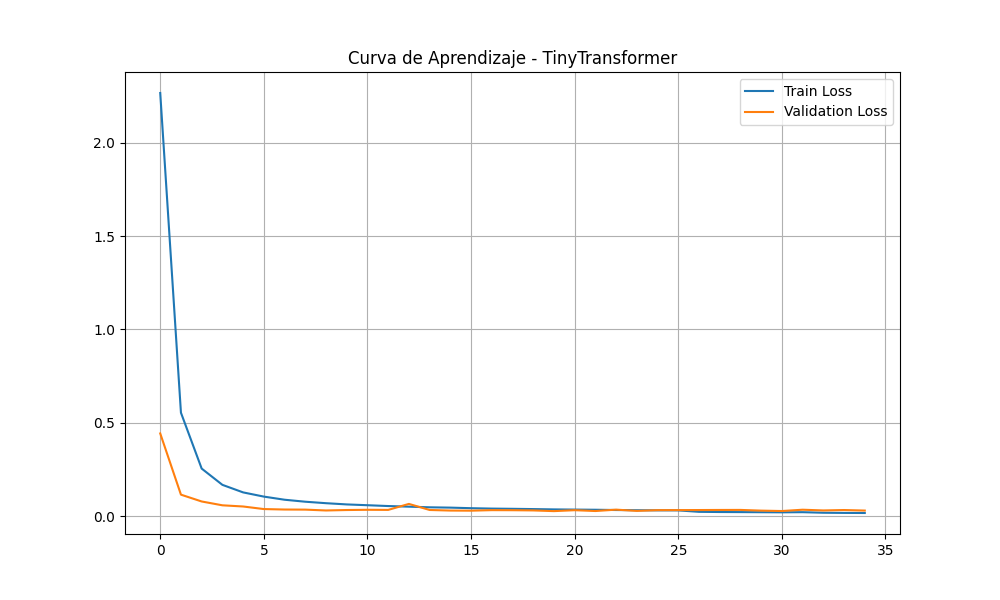
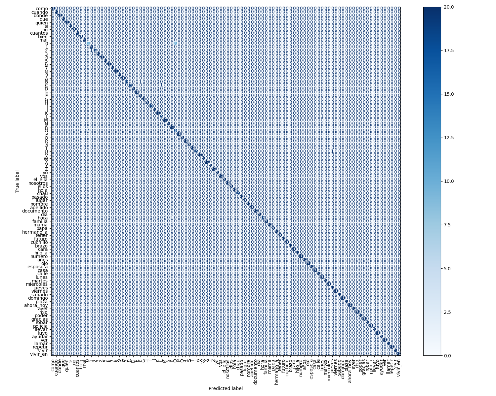

# TinySkeletonClassifier — 100 señas (20/10/2026)

> **Rama:** `scratch-mediapipe-v3`  
> **Checkpoint:** `src/model_new_2026_10_20/tinyskeleton_best.pth`  
> **Métricas:** `src/model_new_2026_10_20/metrics.json` (21/10/2026, 01:33 ART)

El vocabulario quedó cerrado en **100 señas**, con **100 videos por seña**. Sobre esos landmarks se reentrenó TinySkeleton. El modelo guardado alcanza **99,00 %** de accuracy top-1 en validación y una val loss de **0,0278**.

---

## Qué se hizo

Las tres señas que faltaban para llegar a 100 son `gracias`, `ayudar` y `policia`. En el dataset de videos las tres quedaron con 100 clips, igual que el resto del vocabulario: **10.000 videos** (100 clases × 100).

Los landmarks salen del pipeline de esta rama: `@mediapipe/holistic@0.5.1675471629` (JS/WASM, WebGL), pose y dos manos, sin cara. Cada frame es un vector de **225** valores (33×3 de pose + 21×3×2 de manos). La secuencia se resamplea a **16 frames**. Cada `.npy` tiene forma `(16, 225)` y vive en `dataset_landmarks_16frames/<seña>/`.

| Seña nueva | Videos | Landmarks válidos `(16, 225)` |
|---|---:|---:|
| `gracias` | 100 | 100 |
| `ayudar` | 100 | 100 |
| `policia` | 100 | 100 |

`src/config.py` tiene `NUM_CLASSES = 100`, `SAMPLES_PER_CLASS = 100` y las tres entradas en `SIGN_CLASSES`. Al armar el split, las 100 carpetas tenían al menos 100 `.npy`: ninguna clase se descartó.

Ocho carpetas conservan landmarks de extracciones anteriores, por encima de los 100 videos. `train.py` baraja con semilla 42 y se queda con 100 archivos por clase.

| Carpeta | `.npy` en disco | Videos |
|---|---:|---:|
| `Ahora_Hoy` | 160 | 100 |
| `Hermano_a` | 110 | 100 |
| `Mal` | 110 | 100 |
| `Ellos` | 107 | 100 |
| `Hijo_a` | 106 | 100 |
| `1` | 104 | 100 |
| `Mama` | 101 | 100 |
| `Nombre` | 101 | 100 |

La seña `5` tiene tres archivos en cero, de detecciones vacías de Holistic: `5-25.npy`, `5-29.npy` y `5-31.npy`. Dos cayeron en entrenamiento y `5-29.npy` en validación. Ese clip vacío fue contado como acierto de la seña `5`.

---

## Entrenamiento

Corrida guardada en `src/model_new_2026_10_20/`. TinySkeleton es un encoder chico: dos convoluciones 1D (kernel 3, 225→128 y 128→128, batch norm y ReLU), codificación posicional seno/coseno, dos capas de Transformer (4 cabezas, dimensión 128, FFN 256, dropout 0,4), attention pooling y una capa lineal a 100 clases.

El split es **80/20 por clase**, semilla 42: **8.000** clips de entrenamiento y **2.000** de validación (80 y 20 por seña). La aumentación corre solo en entrenamiento, ×25:

| Transformación | Rango |
|---|---|
| Escala | 0,85 – 1,15 |
| Rotación | yaw ±15°, pitch ±8°, roll ±8° |
| Time warp | 0,80 – 1,25 |
| Recorte temporal | hasta 15 % de cada extremo |
| Frames perdidos | hasta 3, luego interpolados |
| Ruido | pose 0,012 · manos 0,027 |

Optimizador AdamW (lr `3,24e-5`, weight decay `0,0145`), pérdida cross-entropy con label smoothing `2,5e-4`, batch 32. El learning rate baja a la mitad si la val loss no mejora en 5 épocas. El tope es 200 épocas, con paciencia 15: se guarda el peso solo cuando la val loss baja, y se corta tras 15 épocas sin un mínimo nuevo.

La corrida hizo **35 épocas** y cortó por esa paciencia. El checkpoint es el de la **época 20**, la última que mejoró la val loss.

---

## Métricas

Reevaluación del checkpoint sobre los 2.000 clips de validación, sin aumentación:

| Métrica | Valor |
|---|---|
| Val loss | **0,0278** |
| Accuracy top-1 | **99,00 %** (1.980 / 2.000) |
| Errores | **20** |
| Clases | 100 / 100 |
| Train / val | 8.000 / 2.000 |
| Épocas corridas | 35 (modelo de la 20) |

La corrida anterior (15/10/2026, `src/model_new_2026_10_15/`) usaba 60 clips por clase: val loss 0,0528 y top-1 99,08 % sobre 1.200 clips. Con 100 clips por clase la pérdida de validación bajó a menos de la mitad. El top-1 queda en 99,00 % porque el conjunto de validación ahora es más grande (20 errores sobre 2.000).

De las 100 señas, **90 no tuvieron ningún error** en validación. Ahí entran `gracias`, `ayudar` y `policia` (20/20 cada una).

Los 20 errores:

| Real | Predicha | Cantidad | Sobre 20 de validación |
|---|---|---:|---:|
| `0` | `O` | 10 | recall de `0`: 10/20 |
| `O` | `0` | 2 | recall de `O`: 18/20 |
| `2` | `1` | 1 | |
| `B` | `F` | 1 | |
| `C` | `L` | 1 | |
| `I` | `C` | 1 | |
| `L` | `lunes` | 1 | |
| `U` | `jueves` | 1 | |
| `chau` | `nombre` | 1 | |
| `hora` | `ñ` | 1 | |

Doce de los veinte errores son el par `0` / `O`. La seña `0` es la clase débil del checkpoint: en validación acierta la mitad de sus clips, y todos los fallos van a la letra `O`.

---

## Gráficos

Quedaron junto al checkpoint.

### Curva de aprendizaje

`src/model_new_2026_10_20/curva_tinyskeleton.png`

Loss de entrenamiento (azul) y de validación (naranja) a lo largo de las 35 épocas. El entrenamiento arranca por encima de 2 y la validación cerca de 0,5. Las dos caen en las primeras cinco épocas y después quedan pegadas al eje. Alrededor de la época 12 la validación tiene un repunte chico y vuelve a bajar. A partir de ahí las curvas se solapan cerca de cero: el corte en la época 35 es la paciencia, no un despegue de la validación respecto del entrenamiento.

### Matriz de confusión

`src/model_new_2026_10_20/matriz_confusion_tinyskeleton.png`

Filas: seña real. Columnas: seña predicha. Cada clase aporta 20 clips, así que la escala de color va de 0 a 20 y la diagonal oscura es un acierto casi completo. Los 20 errores quedan como puntos claros fuera de la diagonal; a esta escala casi no se ven. El único bloque que mueve la diagonal es `0`→`O` (10 de 20). El resto son confusiones de un solo clip, listadas en la tabla de arriba.
